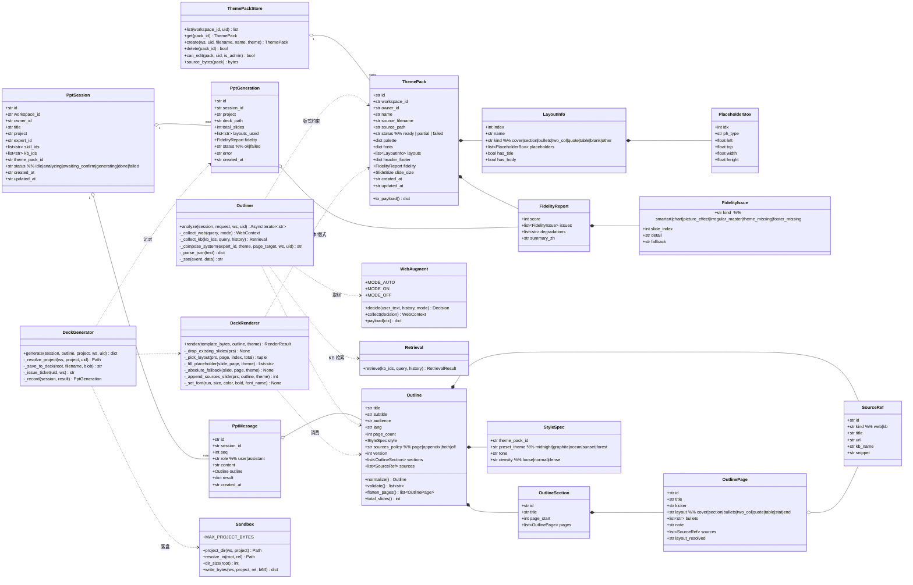
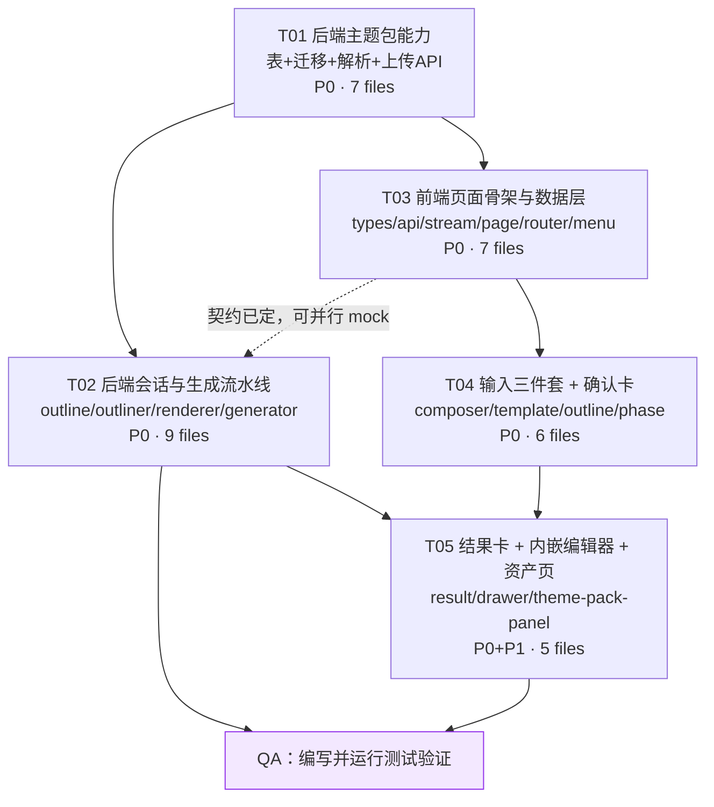

# 架构设计：AI PPT 制作（增量）

> 版本 v0.1 · 2026-11-10 · 架构师 高见远
> 输入：`docs/ppt-studio/PRD.md`（v0.1 增量版，P0 共 8 项）
> 基线：**不重写现有平台**。agents 会话、experts、skills、kb、deck-editor、项目资产、沙箱全部按现状复用，本次只在旁边长出一条 PPT 专用流水线。

---

## 1. 实现方案与框架选型

### 1.1 现状盘点（设计的前提）

| 能力 | 现有实现 | 本次怎么用 |
|---|---|---|
| 项目沙箱 | `services/capabilities/sandbox.py`：`project_dir` / `resolve_in` / `write_bytes`（`BINARY_SUFFIXES` 含 `.pptx`，单文件 32MB，项目 64MB） | 生成结果直接落 `deck/`；保存回传走已有 `PUT /projects/{p}/file-bytes` |
| 二进制写回 | `routes/projects.py::write_file_bytes` + `sandbox.write_bytes(base64)` | **不改**，Ctrl+S 直接复用 |
| 放映级编辑 | `features/deck-editor/DeckCraftFrame.tsx`（消息协议 ready/open/save/dirty/failed）+ `features/browser/components/DeckCraftStage.tsx`（已实现"Ctrl+S → base64 → PUT file-bytes"） | **直接复用 DeckCraftStage** 放进抽屉，不新写保存逻辑 |
| 票据 | `routes/browse.py::GET /ticket` → `services/tickets.issue(uid, ws)` → `{"ticket", "expires_in"}`；`TTL_SEC=900`，`ALLOWED_PREFIXES=("/api/projects/", "/api/browse/")` | 生成完成时后端签票，塞进 `download_url`（iframe 内 fetch 带不了 Authorization）。**票据 15 分钟过期**：`GET /ppt/sessions/{sid}/generations` 每次调用重新签票，前端打开抽屉前用这条兜底 |
| 流式 | `routes/chat.py` 的"生产者任务 + `asyncio.Queue` + 15s 心跳"模式；前端 `features/chat/sse-parser.ts::readSseStream` | 新流水线照抄这套骨架（已验证过长连接不被打断） |
| 联网取材 | `services/web_augment.py`（`MODE_AUTO/ON/OFF`、`decide`/`collect`/`payload`） | 直接用 |
| 知识库取材 | `services/retrieval.py::retrieve(kb_ids, query, history=)` → `hits/citations/error`；`rag.build_context_block` | 直接用 |
| 模型 | `services/llm.py::stream_chat` / `complete`；`services/models.py::resolve` | 直接用（llama.cpp Qwen3.6-27B） |
| PPT 生成 | `services/capabilities/ppt.py`：12 种版式 + 5 套内置主题（`THEMES`），`build_deck(payload)`，绝对坐标绘图 | **不套模板时**走它；套模板时复用它的字体/字号/降级辅助思路，但坐标改由母版占位符决定 |
| 模板解析 | `services/parsers.py::_parse_pptx` 只抽纯文本（喂 KB） | **不够用**，另写 `theme_pack.py` 抽主题/版式（不动 parsers.py） |
| 存储 | `services/templates.py` 是标准双后端范式：`store_backend == "json"` 走 `JsonState`，否则 `TableState` + `db/tables.py` + `db/schema.py` MIGRATIONS | 新 store 全部照这个范式写，保证 sqlite/pg/json 都能跑 |
| 前端骨架 | `app/router.tsx`（lazy 路由）、`app/layout/AppLayout.tsx`（NAV 常量）、`features/agents/AgentsPage.tsx`（左 264px 会话栏 + 右对话区 + 底部 composer） | 布局与交互抄 AgentsPage，组件新建（不复用其内部状态机，那个是 deepagents 专用） |

### 1.2 核心难点与对策

**难点 1：python-pptx 拿不到"主题"**
python-pptx 有母版/版式 API，但**不暴露 clrScheme / fontScheme**。对策：直接读包里的 `ppt/theme/theme1.xml`
（`prs.part.package.iter_parts()` 找 `partname` 以 `/theme/theme` 开头的 part，用 lxml 解析 `a:clrScheme` / `a:fontScheme`），
`sysClr` 取 `lastClr` 兜底。这是唯一可靠路径，别指望 `Presentation` 高层 API。

**难点 2：跨演示文稿复制版式不可行**
python-pptx 没有"把 A 的 slide_layout 复制到 B"的 API（关系 + 母版 + 主题一整套）。
对策：**反向利用**——以用户模板本身为基底 `Presentation(BytesIO(template_bytes))`，先清空其自带示例页
（遍历 `prs.slides._sldIdLst`，`drop_rel` 后移除），再逐页 `add_slide(layout)` + 填占位符。
这样主题/母版/版式继承全是真的，DeckCraft 打开后按母版继承也正常。

**难点 3：版式千奇百怪，占位符不一定齐**
对策：三级降级，逐级记录到保真度报告（P1-2 口径）：
1. 按 `layout_hint` 名字模糊匹配 → 填 `title` / 内容占位符；
2. 匹配不到 → 选该母版下"占位符最多"的版式；
3. 占位符缺失/为空 → 按主题色板与版心安全区 **绝对定位补文本框**（`fallback: absolute_textbox`）；
4. 完全没有可用版式 → 整页走 `ppt.py` 式绝对排版（`fallback: no_layout`）。

**难点 4：确认卡既是 UI 又是生成输入**
对策：一份 `Outline` 数据模型双用——前端可编辑树（卡）←→ 后端渲染输入（`renderer`）。
校验放在后端（`PUT /outline` + `generate` 入口都校验），前端只做轻量提示，避免两套规则漂移。

**难点 5：页数口径**
确认卡显示"内容页"，来源附录页另计。结果卡显示 `total_slides = 内容页 + 附录页`。
口径写死在后端返回里（`page_count` / `total_slides`），前端不做加法。

### 1.3 框架与依赖

不引入新框架。**新增第三方依赖：无。**

- `python-pptx>=1.0` **已在** `server/requirements.txt`（第 47 行），模板解析与生成都用它。
- 前端不加包：图标用已有 `lucide-react`（`Presentation` / `Slideshow` / `Upload` / `Sparkles` 均已有或同库），
  MUI + Tailwind + `@/components/ui/*` 已够用，SSE 用 `features/chat/sse-parser.ts`。
- 若工程师想加 `idb`/`zustand` 之类：**不要**。会话状态就在页面组件里，和 AgentsPage 一致。

### 1.4 PRD 待确认问题的技术结论（5 项决策，请 team-lead 复核）

| # | PRD 问题 | 技术结论 | 理由 |
|---|---|---|---|
| 1 | 模板包共享边界 | **workspace 级共享**：`ppt_theme_packs.workspace_id` 落库，同 workspace 全员可读、可引用、可见于资产页；删除仅 `owner_id` 本人或 admin。不做"部署实例全局" | 项目/沙箱/KB 全是 workspace 隔离；全局共享会跨租户泄露品牌资产与客户名 |
| 2 | 生成前切模板是否重出卡 | **不强制重出卡**。卡只存 `theme_pack_id`，生成时才解析；若卡内 `layout_hint` 与新模板版式集合不匹配，生成前置校验返回 `warnings[]`（"3 页将按近似版式生成"），卡上顶部展示该提示 + 「按新模板重出卡」按钮（复用 P1-3 快捷指令通道） | 用户切模板多半是"换皮不换骨"，强制重出卡等于丢掉已编辑内容 |
| 3 | 落盘项目归属 | **沿用当前项目上下文**（输入区上方项目选择器，默认最近更新项目）；无项目时后端返回 `400 {code:"project_required"}`，前端弹"新建项目"（复用 `POST /api/projects`）。**不自动建项目** | 自动建项目会污染项目列表；复用 `projects.create_project` 语义更干净 |
| 4 | 联网开关/配额 | 本页 P0 固定 `web_mode="auto"`；**请求体已带 `web_mode` 字段**（on/off/auto 三个值后端已支持），P1 加会话级开关只需前端加控件，后端零改动。内网敏感场景由专家层不挂 `web_search` 实现 | 现在加开关是多余 UI；但契约先留好，避免 P1 改协议 |
| 5 | 来源标注形式 | 默认 `sources_policy="both"`：**每页页脚 9pt 灰字角标 + 文末「参考来源」附录页**；卡上可切 `page` / `appendix` / `off`（正式稿隐藏） | 汇报场景既要在页面上经得起追问，也要能一键去掉附录页 |

---

## 2. 文件列表

### 2.1 后端（`server/`）

| # | 路径 | 动作 | 职责（一句话） |
|---|---|---|---|
| 1 | `app/db/tables.py` | 修改 | 新增 4 张表定义 `PPT_THEME_PACKS` / `PPT_SESSIONS` / `PPT_MESSAGES` / `PPT_GENERATIONS`，并加入 `ddl_all()` |
| 2 | `app/db/schema.py` | 修改 | 追加 `_MIGRATION_012`（建 4 表 + 索引），注册进 `MIGRATIONS` |
| 3 | `app/services/ppt_studio/__init__.py` | 新增 | 包入口，导出 `parse_theme_pack` / `build_outline` / `generate_deck` 等公共函数 |
| 4 | `app/services/ppt_studio/theme_pack.py` | 新增 | 解析 .pptx → 主题包（色板/字体/版式/页眉页脚/滑尺）+ 保真度评估 + 源文件落盘 + 主题包 CRUD store |
| 5 | `app/services/ppt_studio/outline.py` | 新增 | `Outline`/`Section`/`Page`/`SourceRef` Pydantic 模型 + 校验规范化 + 大纲→页面清单映射 + 来源聚合 |
| 6 | `app/services/ppt_studio/outliner.py` | 新增 | 取材流水线：联网检索 + KB 检索 + LLM 出卡/追问，产出 SSE 事件流（phase/sources/delta/clarification/outline） |
| 7 | `app/services/ppt_studio/renderer.py` | 新增 | 套母版渲染器：清空模板示例页、版式匹配、占位符填充、三级降级、页脚角标与来源附录页 |
| 8 | `app/services/ppt_studio/generator.py` | 新增 | 生成编排：校验 → 渲染 → 落盘 `deck/*.pptx`（含 64MB 配额） → 写生成记录 → 签票 → 返回结果卡载荷 |
| 9 | `app/services/ppt_studio/session_store.py` | 新增 | 会话/消息/生成记录 store，双后端（`TableState` / `JsonState`），照 `services/templates.py` 范式 |
| 10 | `app/api/routes/ppt.py` | 新增 | 全部 `/api/ppt` 端点：templates 上传/列表/详情/删除；sessions CRUD；analyze / outline / generate |
| 11 | `app/main.py` | 修改 | `app.include_router(ppt.router, prefix="/api")` |
| 12 | `app/services/experts.py` | 修改 | 新增预置专家「PPT 美化专家」（固定 id `ppt-beautifier`）；`ExpertStore.add` 支持显式 id 覆盖 |
| 13 | `tests/test_ppt_theme_pack.py` | 新增 | 主题包解析（用 pptx 现造样本）、保真度降级、可见性/删除权限 |
| 14 | `tests/test_ppt_outline_generate.py` | 新增 | 确认卡校验边界、大纲→页数映射、套母版生成落盘、非法输入 400、项目归属 404 |
| 15 | `tests/test_ppt_routes.py` | 新增 | 端点契约：上传/列表/删除/会话 CRUD/analyze 与 generate 的关键 SSE 帧 |

### 2.2 前端（`web/src/`）

| # | 路径 | 动作 | 职责（一句话） |
|---|---|---|---|
| 16 | `features/ppt-studio/types.ts` | 新增 | 主题包/确认卡/会话/消息/生成结果/SSE 帧的 TS 类型 |
| 17 | `features/ppt-studio/api.ts` | 新增 | `/api/ppt` 访问层：模板上传、会话 CRUD、保存大纲、取票据、错误归一（`{detail}`） |
| 18 | `features/ppt-studio/use-ppt-stream.ts` | 新增 | `useAnalyzeStream` / `useGenerateStream`：复用 `readSseStream`，暴露 phase/sources/outline/clarification/error，带 AbortController |
| 19 | `features/ppt-studio/PptStudioPage.tsx` | 新增 | 页面编排：两栏布局、会话切换、消息流渲染、抽屉状态、空态建议 |
| 20 | `features/ppt-studio/components/SessionSidebar.tsx` | 新增 | 左栏 264px：新建会话 + 历史列表（标题/相对时间/页数）+ 搜索 + 删除 |
| 21 | `features/ppt-studio/components/PptComposer.tsx` | 新增 | 底部输入区：textarea + 三件套（专家下拉 / Skills 多选 / 模板上传）+ 项目选择 + 发送/停止 |
| 22 | `features/ppt-studio/components/TemplatePicker.tsx` | 新增 | 模板下拉 + .pptx 上传，含"解析中 → 已就绪"状态与保真度徽标、删除入口 |
| 23 | `features/ppt-studio/components/OutlineCard.tsx` | 新增 | 可编辑确认卡：章节/页面树（增删改）、页数统计、风格与来源策略选择、来源折叠区、快捷指令（P1-3）、「确认生成」 |
| 24 | `features/ppt-studio/components/PhaseTrack.tsx` | 新增 | 进度条：取材中 / 分析中 / 生成中 / 保存中 / 完成，失败态带重试 |
| 25 | `features/ppt-studio/components/ResultCard.tsx` | 新增 | 生成结果卡：文件名 + 页数 + 保真度摘要 + 「打开编辑器」+ 下载 + 重新生成 |
| 26 | `features/ppt-studio/components/DeckDrawer.tsx` | 新增 | 右侧/全屏抽屉：复用 `DeckCraftStage`（内嵌 DeckCraft + Ctrl+S 经 file-bytes 回传）+ 整页打开 |
| 27 | `features/ppt-studio/components/OutlineCard.test.tsx` | 新增 | vitest：加页/删页/页数统计/校验提示/禁止生成空卡 |
| 28 | `features/ppt-studio/use-ppt-stream.test.ts` | 新增 | vitest：SSE 帧归约（phase→sources→outline；error 中断） |
| 29 | `features/browser/components/ThemePackPanel.tsx` | 新增 | P1：资产页主题包列表：色板缩略、版式数、保真度、删除 |
| 30 | `features/browser/BrowserPage.tsx` | 修改 | P1：挂一个「公司模板」tab 渲染 `ThemePackPanel` |
| 31 | `app/router.tsx` | 修改 | 新增 `/ppt-studio` 懒加载路由（`LazyPage` 包裹） |
| 32 | `app/layout/AppLayout.tsx` | 修改 | 左侧菜单「工作台」组新增「AI PPT 制作」（`Slideshow` 图标），位置在「智能体」之后 |
| 33 | `web/ui-sweep.cjs` | 修改 | 导航文案/菜单项断言同步（脚本第 92 行仍断言旧文案「专家 & 技能 & MCP」，顺手校正） |

> 说明：`web/ppt-studio-e2e.cjs`（上传模板→出卡→生成→抽屉保存 的端到端脚本）列为 **P2 可选**，不进任务硬性范围。

---

## 3. 数据结构与接口

### 3.1 类图

见 `docs/ppt-studio/class-diagram.mermaid`（同内容内联如下）。



### 3.2 关键字段约定

**主题包 `palette`**（缺项用默认值补，`sysClr` 取 `lastClr`）：

```json
{"dk1":"000000","lt1":"FFFFFF","dk2":"1F2937","lt2":"F3F4F6",
 "accent1":"1F4E79","accent2":"2E75B6","accent3":"A5A5A5",
 "accent4":"FFC000","accent5":"5B9BD5","accent6":"70AD47",
 "hlink":"0563C1","folHlink":"954F72"}
```

**主题包 `fonts`**：`{"major_latin","major_ea","minor_latin","minor_ea"}`，`ea` 缺失时回落到 `"Microsoft YaHei"`。

**`FidelityReport.score`**：`100 - Σpenalty`，`clamp(40, 100)`；penalty 表：

| kind | penalty | fallback |
|---|---|---|
| `smartart` | 每处 6（上限 18） | 转为要点列表 |
| `chart` | 每处 5（上限 15） | 转为条形图近似或表格 |
| `picture_effect` | 每处 2（上限 6） | 保留占位说明 |
| `irregular_master` | 12 | 绝对定位文本框排版 |
| `theme_missing` | 20 | 退化为内置 `midnight` 主题 |
| `footer_missing` | 3 | 不做页眉页脚，仅页码 |

**版式 `kind` 判定**（`LayoutInfo.kind`，供 `layout_hint` 匹配）：
名字小写后含 `封面|title slide|标题幻灯片`→`cover`；`节|section|章节`→`section`；
`标题和内容|title and content|内容|content`→`bullets`；`两栏|two content|比较|comparison`→`two_col`；
`引用|quote`→`quote`；`空白|blank`→`blank`；否则 `other`。
`has_title` / `has_body` 由占位符 `ph_type` 决定（title/centerTitle / body/object/subtitle）。

**确认卡校验规则**（`Outline.validate()`，后端为准）：

| 规则 | 违反时 |
|---|---|
| `title` 非空且 ≤ 80 字 | 400 `title_required` / 截断告警 |
| `sections` 1~8 个 | 400 `sections_range` |
| 每 section 1~8 页 | 400 `pages_per_section` |
| 内容页合计 3~30 | 400 `page_count_range` |
| 每页 `bullets` ≤ 8 条、每条 ≤ 120 字 | **告警不拦**（生成时截断并记 `degradations`） |
| `layout` ∈ 枚举 | 归一为 `auto` |
| `style.theme_pack_id` 不可见 | 400 `theme_pack_not_found` |

### 3.3 API 端点

前缀 `/api/ppt`，全部 `Depends(current_workspace)` + `Depends(current_uid)`；不可见资源一律 **404**（不泄露存在性）。
**路由函数体没有 `await` 就必须写 `def`**（`server/tests/test_route_sync.py` 会拦）。

#### 3.3.1 主题包（模板）

| 方法 | 路径 | 请求 | 响应 |
|---|---|---|---|
| POST | `/ppt/templates` | `multipart/form-data`：`file`（.pptx）、`name?` | `ThemePack payload`（见下） |
| GET | `/ppt/templates` | — | `[{id,name,owner_id,status,layout_count,fidelity_score,swatches:[hex×5],created_at}]` |
| GET | `/ppt/templates/{pack_id}` | — | `ThemePack payload` 全量（含 `layouts`） |
| DELETE | `/ppt/templates/{pack_id}` | — | `{ok:true}`；非 owner 且非 admin → 403 |

`ThemePack payload`：

```json
{
  "id": "tp_9f2c1a",
  "name": "公司季度模板",
  "owner_id": "u_1",
  "status": "ready",
  "source_filename": "brand-2026.pptx",
  "created_at": "2026-11-10T09:12:00+00:00",
  "slide_size": {"width_in": 13.333, "height_in": 7.5},
  "palette": {"accent1": "1F4E79", "...": "..."},
  "fonts": {"major_ea": "思源黑体", "minor_ea": "思源黑体", "major_latin": "Arial", "minor_latin": "Arial"},
  "layouts": [{"index":0,"name":"标题幻灯片","kind":"cover","has_title":true,"has_body":false,
               "placeholders":[{"idx":0,"ph_type":"CENTER_TITLE","left":0.9,"top":2.0,"width":11.5,"height":1.6}]}],
  "header_footer": {"has_slide_number": true, "has_date": false, "snippets": ["内部资料"]},
  "fidelity": {"score": 82, "summary_zh": "8 页完整解析；1 处 SmartArt 转为要点列表",
               "issues": [{"kind":"smartart","slide_index":3,"detail":"检测到 1 处 SmartArt 图形","fallback":"转为要点列表"}],
               "degradations": ["2 个版式无内容占位符，将用绝对定位补文本框"]}
}
```

上传约束（`async def`，因为要 `await file.read()`）：后缀必须 `.pptx`（`.ppt` 明确拒绝并提示另存为 .pptx）；
体积 ≤ 32MB（超限 400 `template_too_large`）；`zipfile` 结构损坏 / 非 pptx → 400 `template_invalid`；
解析超时（单文件 20s）→ 400 `template_parse_timeout`。

#### 3.3.2 会话

| 方法 | 路径 | 请求 | 响应 |
|---|---|---|---|
| GET | `/ppt/sessions` | `?limit=50` | `[{id,title,project,theme_pack_id,status,page_count,total_slides,created_at,updated_at}]` |
| POST | `/ppt/sessions` | `{title?, project?, expert_id?, skill_ids?, kb_ids?, theme_pack_id?}` | `PptSession` |
| GET | `/ppt/sessions/{sid}` | — | `{session, messages:[PptMessage]}`（刷新恢复用） |
| DELETE | `/ppt/sessions/{sid}` | — | `{ok:true, deleted_messages:n}`（不删已生成的 deck 文件） |

#### 3.3.3 分析出卡（SSE）

`POST /ppt/sessions/{sid}/analyze`

```json
{
  "prompt": "做一份 Q3 经营复盘，8 页左右，面向管理层",
  "project": "q3-review",
  "expert_id": "ppt-beautifier",
  "skill_ids": ["sk_1"],
  "kb_ids": ["kb_fin"],
  "theme_pack_id": "tp_9f2c1a",
  "web_mode": "auto",
  "page_target": 8
}
```

SSE 事件序（`event:` 名 + `data:` JSON）：

| event | data | 说明 |
|---|---|---|
| `meta` | `{session_id, message_id}` | 首帧，前端记住 message_id |
| `phase` | `{phase, label, progress}` | `collecting(10)` → `kb(35)` → `outlining(55)` → `ready(100)`；或 `clarifying(100)` |
| `web` | `{status, mode, query?, results?, reason?}` | 透传 `web_augment.payload`，status ∈ checking/searching/done/skipped/failed |
| `sources` | `{sources:[SourceRef]}` | 联网 + KB 合并去重后的来源清单（卡上折叠区） |
| `delta` | `{text}` | 模型流式解说文字（**不是** JSON） |
| `clarification` | `{question, options?:[str]}` | 需求有歧义时**只发这一种结果**，不发 outline；`session.clarify_count += 1` |
| `outline` | `{outline}` | 结构化确认卡；`session.status = "awaiting_confirm"` |
| `error` | `{message, retryable}` | 失败；HTTP 仍 200（流已开），靠帧报错 |
| `done` | `{message_id}` | 收尾 |

歧义规则：`session.clarify_count >= 1` 时**禁止**再进 clarification 分支（模型提示词里直接要求出卡）——满足"仅追问一次"。

#### 3.3.4 保存确认卡

`PUT /ppt/sessions/{sid}/outline`

```json
{"outline": { ...Outline... }, "message_id": "msg_3"}
```

响应：`{outline, page_count, total_slides, warnings:["第 2 页要点 9 条，超出 8 条将被截断"]}`。校验失败 400 带上述错误码。

#### 3.3.5 生成（SSE）

`POST /ppt/sessions/{sid}/generate`

```json
{"outline": {...}, "project": "q3-review", "filename": "Q3经营复盘"}
```

`outline` 省略时用会话里最后一份已保存大纲。SSE：

| event | data |
|---|---|
| `phase` | `{phase:"validating"\|"rendering"\|"saving", progress, label}` |
| `done` | `{generation_id, deck:{project,path,name,bytes,ticket,download_url,editor_url}, page_count, total_slides, layouts_used, fidelity}` |
| `error` | `{message, retryable}`（`retryable=false` 表示输入非法，重试无用） |

`deck.download_url = /api/projects/{project}/download?path={path}&ticket={ticket}`；
`deck.editor_url = /deckcraft`（整页打开时配 `stageHandoff`）。
`project` 缺失 → `400 {detail:"project_required", code:"project_required"}`。

`GET /ppt/sessions/{sid}/generations` → 历史结果卡 `[{generation_id, project, deck_path, total_slides, fidelity, created_at, deck:{ticket, download_url}}]`。
**每次调用重新签票**（票据 TTL 900s）：前端在打开抽屉前若距上次生成超过 10 分钟，先拉这条刷新 `download_url`，否则 iframe 里的 fetch 会 401。

#### 3.3.6 与现有 deckcraft 消息协议的衔接（不改协议）

```
DeckDrawer
  └─ DeckCraftStage(project, path, ticket, onSaved)      ← 现有组件，原样复用
        ├─ deckUrl = /api/projects/{p}/download?path=…&ticket=…   ← 后端签票
        ├─ DeckCraftFrame.postMessage("deckcraft:open", {name, bytes})
        ├─ on "deckcraft:save" → saveFileBytes(project, path, bytes)
        │     → PUT /api/projects/{p}/file-bytes → sandbox.write_bytes（.pptx 白名单 / 32MB）
        └─ on "deckcraft:dirty" → 抽屉底部显示"有未保存改动 · Ctrl+S"
```

新增的只有"谁来提供 ticket 与 path"：`generate.done.deck` 里已带，前端不自己拼。
`deckcraft:failed` 原样落到底部状态条，并给"重新载入"按钮（重调 `frame.open(deckUrl)`）。

### 3.4 生成渲染算法（`DeckRenderer.render`，工程师按此实现）

```
输入：template_bytes | None, outline, theme(ThemePack|内置 preset)
1. prs = Presentation(BytesIO(template_bytes)) if template_bytes else Presentation()
   - 无模板时按 preset 主题走 capabilities/ppt.py 的 build_deck（本文件不管）
2. _drop_existing_slides(prs)   # 遍历 prs.slides._sldIdLst，drop_rel + remove
3. for index, page in enumerate(outline.flatten_pages()):
     layout, degradation = _pick_layout(prs, page, index, len(pages))
     slide = prs.slides.add_slide(layout)
     degradations += _fill_placeholder(slide, page, theme)   # 返回本页降级项
     slide.notes_slide.notes_text_frame.text = page.note or ""
     若 page.sources 且 policy ∈ {page,both} → 页脚上方 9pt 灰字 "来源：1,2"
4. total = len(slides); total += _append_sources_slide(...)  # policy ∈ {appendix,both}
5. 输出 bytes = prs.save(BytesIO())；返回 {blob, total_slides, layouts_used, degradations}
```

`_pick_layout` 顺序：`page.layout_resolved`（前端选定）→ `page.layout` 语义名 → 名字关键词匹配 → `has_body` 优先 → 占位符最多 → 无版式则 `absolute`。
`_fill_placeholder`：`slide.shapes.title` 填标题（字号按长度 40/34/28）；正文占位符填 bullets（字号按条数与最长字数 20/18/16/14，超限截断到 8 条）；
字号与字体一律用主题包 `fonts.minor_ea` / `major_ea` 与 `palette.dk1/lt1`（深色版式按背景亮度判断前景色）。
**字体名的 `a:ea` / `a:cs` 也要设**（复用 `capabilities/ppt.py::_set_font` 里 `qn("a:ea")` 那段，否则中文回落宋体）。

---

## 4. 程序调用流程

见 `docs/ppt-studio/sequence-diagram.mermaid`（同内容内联如下）。

```mermaid
sequenceDiagram
    autonumber
    actor U as 用户
    participant FE as PptStudioPage<br/>(PptComposer/TemplatePicker)
    participant API as /api/ppt<br/>(routes/ppt.py)
    participant TP as ThemePackService
    participant SS as SessionStore
    participant OUT as Outliner
    participant WEB as web_augment
    participant RAG as retrieval
    participant LLM as llm.stream_chat
    participant REN as DeckRenderer
    participant GEN as DeckGenerator
    participant SB as sandbox
    participant PRJ as projects 表
    participant DC as DeckCraftStage<br/>(iframe)
    const as 取值
    participant SAVE as PUT 项目 file-bytes

    rect rgb(238, 246, 255)
    note over U,TP: ① 上传公司模板 → 主题包
    U->>FE: 选 .pptx 后点上传
    FE->>API: POST /ppt/templates (multipart)
    API->>API: 校验后缀/体积(≤32MB)
    API->>TP: parse_theme_pack(bytes, filename)
    TP->>TP: Presentation(BytesIO) 读母版/版式/占位符
    TP->>TP: 解析 theme1.xml → clrScheme / fontScheme
    TP->>TP: 扫描 SmartArt/图表 → FidelityReport
    TP->>TP: 源文件落盘 data/ppt_templates/<ws>/<id>.pptx
    TP-->>API: ThemePack
    API-->>FE: 200 {id, palette, layouts, fidelity}
    note right of FE: 上传按钮：解析中 → 已就绪（挂保真度徽标）
    end

    rect rgb(240, 255, 244)
    note over U,SS: ② 输入需求 → 会话
    U->>FE: 输入需求 + 选专家(默认 ppt-beautifier) + Skills + 模板
    FE->>API: POST /ppt/sessions {project, expert_id, skill_ids, theme_pack_id}
    API->>PRJ: projects.require(ws, project, uid)
    API->>SS: create_session(...)
    SS-->>FE: PptSession
    end

    rect rgb(255, 250, 238)
    note over FE,LLM: ③ 取材 → 确认卡（SSE）
    FE->>API: POST /ppt/sessions/{sid}/analyze (SSE)
    API->>SS: append_message(user) / clarify_count 读取
    API-->>FE: event: meta {session_id, message_id}
    API->>OUT: analyze(session, req, ws, uid)
    OUT-->>FE: event: phase {collecting, 10}
    OUT->>WEB: decide(prompt, history, web_mode)
    WEB-->>OUT: Decision{search, query}
    OUT-->>FE: event: web {searching, query}
    OUT->>WEB: collect(decision)
    WEB-->>OUT: WebContext{block, results}
    OUT-->>FE: event: web {done, results}
    OUT-->>FE: event: phase {kb, 35}
    OUT->>RAG: retrieve(kb_ids, prompt, history)
    RAG-->>OUT: {hits, citations, error?}
    OUT-->>FE: event: sources {sources[]}
    OUT-->>FE: event: phase {outlining, 55}
    OUT->>LLM: stream_chat(system=PPT大纲专家+主题约束+来源规则)
    LLM-->>OUT: token 流
    OUT-->>FE: event: delta {text}
    alt 需求有歧义 且 clarify_count == 0
        OUT-->>FE: event: clarification {question}
        OUT->>SS: status=idle, clarify_count+1
        note right of FE: 只追问一次；用户补充后再 analyze
    else 需求明确
        OUT->>OUT: _parse_json(text) + Outline.normalize()
        OUT->>SS: append_message(assistant, outline), status=awaiting_confirm
        OUT-->>FE: event: outline {outline}
        OUT-->>FE: event: done
    end
    end

    rect rgb(248, 240, 255)
    note over U,SS: ④ 卡上编辑（本地即时生效）
    U->>FE: 改标题/加删页/改要点/换风格/切来源策略
    FE->>API: PUT /ppt/sessions/{sid}/outline {outline}
    API->>API: Outline.validate() → warnings[]
    API->>SS: 覆盖消息 payload.outline
    API-->>FE: {outline, page_count, total_slides, warnings}
    end

    rect rgb(255, 240, 242)
    note over FE,SAVE: ⑤ 确认生成 → 落盘
    U->>FE: 点「确认生成」
    FE->>API: POST /ppt/sessions/{sid}/generate (SSE) {outline, project, filename}
    API-->>FE: event: phase {validating, 15}
    API->>API: Outline.validate() + 版式匹配预检(warnings)
    API-->>FE: event: phase {rendering, 55}
    API->>GEN: generate(session, outline, project, ws, uid)
    GEN->>TP: get(theme_pack_id) / source_bytes
    GEN->>REN: render(template_bytes, outline, theme)
    REN->>REN: 清空示例页 → 逐页 add_slide(layout) → 填占位符 → 来源附录页
    REN-->>GEN: {blob, total_slides, layouts_used, degradations}
    GEN->>SB: resolve_in(project_dir, "deck/<name>.pptx") + 体积配额校验
    SB-->>GEN: 写盘完成 {path, bytes}
    GEN->>GEN: 签票 tickets.issue(uid, ws)
    GEN->>SS: insert PptGeneration(ok)
    API-->>FE: event: phase {saving, 90}
    API-->>FE: event: done {deck:{project,path,name,bytes,ticket,download_url}, fidelity}
    FE->>FE: 渲染 ResultCard（页数 + 保真度 + 打开编辑器）
    end

    rect rgb(238, 250, 252)
    note over FE,SAVE: ⑥ 内嵌 DeckCraft 编辑 → Ctrl+S 回传
    U->>FE: 点「打开编辑器」
    FE->>DC: 打开抽屉，deckUrl = deck.download_url（含 ticket）
    DC->>DC: fetch(bytes) → postMessage("deckcraft:open")
    DC-->>FE: "deckcraft:ready"
    U->>DC: 编辑（改版式/文字）
    DC-->>FE: "deckcraft:dirty" → 底部"有未保存改动 · Ctrl+S"
    U->>DC: Ctrl+S
    DC-->>FE: "deckcraft:save" {name, bytes}
    FE->>SAVE: PUT /api/projects/{p}/file-bytes {path, content_base64}
    SAVE->>SB: write_bytes（.pptx 白名单 / 32MB / 64MB 配额）
    SB-->>SAVE: {bytes, previous_bytes, created}
    SAVE-->>FE: 200
    FE->>U: 底部状态条「已写回 deck/xxx.pptx（1.2MB，原 1.1MB）」
    end

    rect rgb(250, 250, 250)
    note over U,FE: ⑦ 失败与恢复
    alt 生成失败
        API-->>FE: event: error {message, retryable:true}
        FE->>U: PhaseTrack 红态 + 「重试」（同参数重发 generate）
    else 刷新页面
        FE->>API: GET /ppt/sessions/{sid}
        API-->>FE: {session, messages[]}（含历史 outline 与 result）
        FE->>U: 恢复消息流，结果卡可再次打开抽屉
    end
    end
```

---

## 5. 任务列表（给工程师寇豆码的直接输入）

**5 个任务，按依赖顺序。每个任务都可独立开工、独立验收。**

### T01 · 后端主题包能力（P0）

| 项 | 内容 |
|---|---|
| **涉及文件** | `server/app/db/tables.py`（改）<br/>`server/app/db/schema.py`（改）<br/>`server/app/services/ppt_studio/__init__.py`（新）<br/>`server/app/services/ppt_studio/theme_pack.py`（新）<br/>`server/app/api/routes/ppt.py`（新，**本任务只写 templates 四个端点**）<br/>`server/app/main.py`（改）<br/>`server/tests/test_ppt_theme_pack.py`（新） |
| **依赖** | 无 |
| **优先级** | P0 |

**步骤（按序做）**
1. `db/tables.py`：照 `TASK_TEMPLATES` 范式定义 4 张表（本任务只用 `PPT_THEME_PACKS`，另外 3 张一起建，省一次迁移）：
   - `ppt_theme_packs(id, workspace_id, owner_id, name, source_filename, source_path, status, palette json, fonts json, layouts json, meta json, fidelity json, created_at, updated_at)`，`order="updated_at DESC"`
   - `ppt_sessions(id, workspace_id, owner_id, title, project, expert_id, skill_ids json, kb_ids json, theme_pack_id, status, clarify_count int, page_count int, total_slides int, created_at, updated_at)`
   - `ppt_messages(id, session_id, seq int, role, content, payload json, created_at)`
   - `ppt_generations(id, session_id, project, deck_path, total_slides int, layouts_used json, fidelity json, status, error, created_at)`
   - 4 张表都加进 `ddl_all()` 的返回元组
2. `db/schema.py`：追加 `_MIGRATION_012`（`CREATE TABLE IF NOT EXISTS` × 4 + 索引 `idx_ppt_pack_ws`、`idx_ppt_sess_ws`、`idx_ppt_msg_sess`、`idx_ppt_gen_sess`），注册 `(12, _MIGRATION_012)`。**只增不改**。
   > **勘误（实现时修正）**：012~021 号迁移已被既有功能占用（切片嵌入指纹、告警、任务模板、run_events 等），按「只增不改、已应用编号绝不复用」的纪律，本功能实际追加 `_MIGRATION_022` 并注册 `(22, _migration_022)`，表结构与索引清单与本文一致。
3. `theme_pack.py`：
   - `parse_theme_pack(raw: bytes, filename: str) -> dict`：`Presentation(BytesIO(raw))` → 滑尺、母版版式+占位符、theme XML（`iter_parts()` 找 `/theme/theme`）、SmartArt/图表扫描、页脚片段采样 → 组装 `ThemePack` + `FidelityReport`
   - 源文件落盘：`DATA_DIR / "ppt_templates" / slugify(ws) / f"{pack_id}.pptx"`
   - store 双后端：`_use_table()` / `_all()` / `_save_all()` 照 `services/templates.py`；`list_packs(ws, uid)` / `get_pack(pack_id)` / `create_pack(...)` / `delete_pack(...)` / `source_bytes(pack)` / `can_edit(pack, uid, is_admin)`
4. `routes/ppt.py`：`router = APIRouter(prefix="/ppt", tags=["ppt"])`；只实现 templates 4 个端点（上传写 `async def`，其余 `def`）。上传逻辑：后缀 `.pptx` 校验 → 32MB 校验 → `await file.read()` → `parse_theme_pack` → 落盘 → 入库 → 返回 payload。
5. `main.py`：`from app.api.routes import ppt` + `app.include_router(ppt.router, prefix="/api")`（紧跟 `template_routes` 之后）。
6. `tests/test_ppt_theme_pack.py`：
   - 用 python-pptx 现造一份样本（含 1 个 title 版式 + 1 个带 SmartArt `graphicData` 的页）验证 `parse_theme_pack` 的 palette/fonts/layouts/fidelity.score
   - `template_invalid`（喂 `b"not a zip"`）→ 400
   - `template_too_large`（构造 33MB bytes，`monkeypatch` 上限更省）
   - 可见性：他人 workspace 的 pack 在 `GET /ppt/templates` 不出现，`GET /ppt/templates/{id}` 404
   - 删除权限：owner 可删、他人 403

**验收**：`pytest server/tests/test_ppt_theme_pack.py -q` 全绿；`GET /api/ppt/templates` 在只有 json 后端（`APP_STORE_BACKEND=json`）下也能跑通；`test_route_sync.py` 不报新违规。

---

### T02 · 后端会话与生成流水线（P0）

| 项 | 内容 |
|---|---|
| **涉及文件** | `server/app/services/ppt_studio/outline.py`（新）<br/>`server/app/services/ppt_studio/outliner.py`（新）<br/>`server/app/services/ppt_studio/renderer.py`（新）<br/>`server/app/services/ppt_studio/generator.py`（新）<br/>`server/app/services/ppt_studio/session_store.py`（新）<br/>`server/app/api/routes/ppt.py`（改，补 sessions / analyze / outline / generate）<br/>`server/app/services/experts.py`（改）<br/>`server/tests/test_ppt_outline_generate.py`（新）<br/>`server/tests/test_ppt_routes.py`（新） |
| **依赖** | T01（表结构 + 主题包 store） |
| **优先级** | P0 |

**步骤（按序做）**
1. `services/experts.py`：`PRESET_EXPERTS` 新增一条「PPT 美化专家」，**带 `"id": "ppt-beautifier"`**；
   `ExpertStore.add` 支持 `id=kwargs.get("id") or uuid4().hex[:12]`（保证前端能硬编码这个 id）。
   人设要点：信息密度、标题字数上限、每页一个论点、图表优先于 bullet、套模板时不改母版配色。
   `tool_ids` 给 `_WEB + _FILES`（生成由流水线自己调，不靠 agent 调 `ppt_create`）。
2. `outline.py`：Pydantic 模型（`Outline` / `OutlineSection` / `OutlinePage` / `SourceRef` / `StyleSpec`）+
   `normalize()`（补 id、layout 归一、sources 去重）+ `validate()`（见 3.2 表）+ `flatten_pages()` + `total_slides()`。
   **模型放服务层，不放路由层**——`renderer` 与 `outliner` 都要用。
3. `session_store.py`：会话/消息/生成记录 CRUD，双后端；`append_message(sid, role, content, payload)` 内部管 `seq`；
   `update_status(sid, status, **fields)`；`bump_clarify(sid)`；`latest_outline(sid)`。
4. `outliner.py`：
   - `analyze(session, req, ws, uid) -> AsyncIterator[str]`：照 `routes/chat.py` 的"生产者任务 + Queue + 15s ping"骨架
   - `_collect_web` 用 `web_augment.decide/collect/payload`；`_collect_kb` 用 **`await retrieval.retrieve(...)`**（注意它是 `async def`）+ `rag.build_context_block`
   - 系统提示：角色（PPT 大纲策划）+ 输出契约（严格 JSON：`{"outline":{...}}` 或 `{"clarification":{"question":"..."}}`）+ 主题约束（页数、风格、版式枚举）+ 来源规则（每个数据/引文必须挂 `sources[].id`）+ 标题字数上限
   - `_parse_json`：先剥 ```json 围栏，再 `json.loads`，失败则 `raw_decode` 找第一个完整对象；仍失败 → 抛 `OutlineParseError` → `error` 帧 `retryable=true`
   - `clarify_count >= 1` 时提示词里换成"不再追问，直接出卡"
5. `renderer.py`：按 3.4 算法实现；`_set_font` 必须同时设 `run.font.name` 与 `a:ea`/`a:cs` 的 `typeface`（中文回落问题）。
6. `generator.py`：`generate(session, outline, project, ws, uid)`：
   `projects.require` → 主题包取 bytes（无模板走 `ppt.build_deck` 分支）→ `renderer.render` → `sandbox.resolve_in(root, f"deck/{safe_name}.pptx")`
   → 配额校验（`sandbox.dir_size` + `MAX_PROJECT_BYTES`）→ 同名自动 `-2`/`-3` **不覆盖** → `target.write_bytes`
   → `tickets.issue(uid, ws)["ticket"]` → 写 `ppt_generations` → 返回结果卡载荷。
7. `routes/ppt.py` 补端点：sessions CRUD、`analyze`（SSE）、`PUT outline`、`generate`（SSE）、`generations`。
   SSE 用 `StreamingResponse(..., media_type="text/event-stream", headers={"Cache-Control":"no-cache","X-Accel-Buffering":"no"})`。
8. 测试：
   - `test_ppt_outline_generate.py`：校验边界（2 页 400 / 31 页 400 / 9 条要点只告警）、`flatten_pages` 页数与 `total_slides`（含附录）、套样本模板生成后 `Presentation(bytes)` 能打开且页数吻合、字体名等于主题包 `minor_ea`、SmartArt 模板生成后 `fidelity.degradations` 非空、项目不存在 → 404
   - `test_ppt_routes.py`：会话 CRUD、`analyze` 的帧序（用 `monkeypatch` 替换 `web_augment.collect` / `retrieval.retrieve` / `llm.stream_chat`，不打真模型）、`generate` 缺 project → 400 `project_required`、生成后 `location` 落在 `projects/<ws>/<p>/deck/`

**验收**：`pytest server/tests -q` 仍 272+ 全绿；手工 `curl` 一遍上传→analyze→outline→generate 能拿到 `deck.pptx` 且 PowerPoint/DeckCraft 能打开。

---

### T03 · 前端页面骨架与数据层（P0）

| 项 | 内容 |
|---|---|
| **涉及文件** | `web/src/features/ppt-studio/types.ts`（新）<br/>`web/src/features/ppt-studio/api.ts`（新）<br/>`web/src/features/ppt-studio/use-ppt-stream.ts`（新）<br/>`web/src/features/ppt-studio/PptStudioPage.tsx`（新）<br/>`web/src/features/ppt-studio/components/SessionSidebar.tsx`（新）<br/>`web/src/app/router.tsx`（改）<br/>`web/src/app/layout/AppLayout.tsx`（改） |
| **依赖** | T01（`/ppt/templates` 契约落地即可开工，analyze 可先用 mock） |
| **优先级** | P0 |

**步骤**
1. `AppLayout.tsx`：`NAV[0].items` 在「智能体」之后插 `{ to: "/ppt-studio", label: "AI PPT 制作", icon: Slideshow }`（`lucide-react` 导入 `Slideshow`）。
2. `router.tsx`：`const PptStudioPage = lazy(...)`，在 `agents` 路由后加 `{ path: "ppt-studio", element: <LazyPage><PptStudioPage /></LazyPage> }`。
3. `types.ts`：按 3.1 的接口写 TS 类型（`ThemePack` / `Outline` / `OutlineSection` / `OutlinePage` / `SourceRef` / `PptSession` / `PptMessage` / `PptGeneration` / `PptPhase` / SSE 帧联合类型）。
4. `api.ts`：`request<T>` 照 `features/browser/api.ts` 的写法（`{detail}` 归一）；导出 `listTemplates / uploadTemplate(file) / deleteTemplate / listSessions / createSession / getSession / deleteSession / saveOutline / listGenerations`；上传用 `FormData`（**不要**手写 `Content-Type`）。
5. `use-ppt-stream.ts`：`useAnalyzeStream()` / `useGenerateStream()`，内部 `readSseStream(res.body, applyEvent)`；
   状态机：`{phase, progress, web, sources, deltas, outline, clarification, error, running}`；`abort()` 用 `AbortController`（同 `use-chat-stream.ts` 范式）。
6. `SessionSidebar.tsx`：抄 `features/agents/components/TaskSidebar.tsx` 的视觉与分组（今天/昨天/近 7 天），数据源换成 `PptSession`。
7. `PptStudioPage.tsx`：两栏 + 顶栏 + 消息流 + 底部槽位；空态给 3 条建议（"季度经营复盘"/"产品发布会"/"项目结项汇报"）。

**验收**：`/ppt-studio` 可从菜单进入、路由可深链、布局与 agents 页对齐（左 264px 可收起）；`npx tsc --noEmit` 通过；`vitest` 不回归。

---

### T04 · 输入三件套 + 可编辑确认卡（P0）

| 项 | 内容 |
|---|---|
| **涉及文件** | `web/src/features/ppt-studio/components/PptComposer.tsx`（新）<br/>`web/src/features/ppt-studio/components/TemplatePicker.tsx`（新）<br/>`web/src/features/ppt-studio/components/OutlineCard.tsx`（新）<br/>`web/src/features/ppt-studio/components/PhaseTrack.tsx`（新）<br/>`web/src/features/ppt-studio/components/OutlineCard.test.tsx`（新）<br/>`web/src/features/ppt-studio/use-ppt-stream.test.ts`（新） |
| **依赖** | T03（页面骨架 + 类型/API） |
| **优先级** | P0 |

**步骤**
1. `PptComposer.tsx`：textarea（`Cmd/Ctrl+Enter` 发送）+ 三件套：
   - 专家下拉：`GET /api/experts`（过滤 `status==="live"`），**默认选中 `ppt-beautifier`**，找不到时回落第一项并提示
   - Skills 多选：`GET /api/skills`（`enabled !== false`），chips 多选
   - `<TemplatePicker />` 嵌在右侧
   - 项目选择器复用 `GET /api/projects`（默认最近 `updated_at`），无项目时禁发并给"新建项目"
2. `TemplatePicker.tsx`：下拉选已有主题包（显示 `色板缩略 + fidelity.score`）+ 上传按钮；
   状态机 `idle → uploading → parsing → ready | failed`；**解析中禁用发送**；`failed` 展示后端 `detail` 并允许删掉重传。
3. `OutlineCard.tsx`：受控组件（`value: Outline` + `onChange`）——
   - 顶部：标题输入、`内容页 N + 来源页 M`、风格选择（主题包 / 内置 preset）、来源策略三选一
   - 章节树：章节标题可编辑、章节内页面可增删、页内要点逐条可编辑（`+ 要点` / 删条目）、`layout` 下拉（中文标签）
   - 底部：快捷指令 chips（更多页/更少页/换个风格 → P1-3，走 `onQuickAction(action)`）+ 「确认生成」+ 保存中/失败态
   - 校验提示区：`warnings[]` 黄条
   - 来源折叠区：按 `kind` 分组，`web` 给外链、`kb` 给文档名
4. `PhaseTrack.tsx`：5 段进度（取材 / 分析 / 生成 / 保存 / 完成），失败红态 + 「重试」。
5. 测试：`OutlineCard.test.tsx`（加页/删页/页数联动/空标题禁生成/要点超 8 条出提示）；`use-ppt-stream.test.ts`（构造 ReadableStream 喂帧，断言 outline 覆盖与 error 中断）。

**验收**：`npx vitest run features/ppt-studio` 全绿；手工走一遍"上传模板 → 出卡 → 改卡 → 保存大纲"看到 `PUT /outline` 200。

---

### T05 · 结果卡 + 内嵌编辑器 + 资产页（P0 + P1）

| 项 | 内容 |
|---|---|
| **涉及文件** | `web/src/features/ppt-studio/components/ResultCard.tsx`（新）<br/>`web/src/features/ppt-studio/components/DeckDrawer.tsx`（新）<br/>`web/src/features/browser/components/ThemePackPanel.tsx`（新，P1）<br/>`web/src/features/browser/BrowserPage.tsx`（改，P1）<br/>`web/ui-sweep.cjs`（改） |
| **依赖** | T02（generate 契约）、T04（卡与消息流） |
| **优先级** | P0（ResultCard/DeckDrawer）/ P1（ThemePackPanel） |

**步骤**
1. `ResultCard.tsx`：`文件名 + 页数（内容 + 来源）+ 版式使用摘要 + 保真度徽标（点击展开 issues/degradations）`；
   按钮：`打开编辑器`（开抽屉）、`下载`（`deck.download_url`）、`重新生成`（同参数重发 generate）。
2. `DeckDrawer.tsx`：右侧抽屉（`min(720px, 92vw)`，可全屏切换）内挂 **`DeckCraftStage`**：
   ```tsx
   <DeckCraftStage project={deck.project} path={deck.path} ticket={deck.ticket}
                   onSaved={() => onSaved?.(deck.path)} />
   ```
   头部：文件名 + 「整页打开」（`stageHandoff({url, name})` + `window.open("/deckcraft")`）+ 关闭（脏数据时用 `confirmDialog` 二次确认）。
   **不要**新写保存逻辑，`DeckCraftStage` 已经把 Ctrl+S → base64 → `PUT file-bytes` 做完了。
3. `ThemePackPanel.tsx`：主题包列表（色板 5 色块、版式数、保真度、创建时间、删除）；
   `BrowserPage.tsx` 加一个 tab（沿用现有 tab 常量结构）渲染它。
4. `ui-sweep.cjs`：第 92 行断言文案校正为「专家 · 技能 · MCP」；如有菜单项数量断言同步 +1。

**验收**：生成后点「打开编辑器」抽屉能打开 pptx、改一页、Ctrl+S 后底部显示"已写回"、刷新资产页文件大小变化；`node web/ui-sweep.cjs` 通过。

---

## 6. 共享知识（跨文件约定）

1. **命名**：后端 `snake_case`（表名/字段/函数）、前端 `camelCase`（TS 字段与组件 props）；表一律 `ppt_` 前缀，API 一律 `/api/ppt/*`。
2. **归属与可见性**：所有端点都带 `current_workspace` + `current_uid`；资源不可见与不存在**同一个返回**（404，中文 detail），不做"存在但无权"的区分。
3. **路由同步/异步**：函数体没有 `await` 就写 `def`（FastAPI 会自动丢线程池）；有 `await`（上传、SSE 生成器）才 `async def`。`server/tests/test_route_sync.py` 会拦。
4. **错误约定**：普通 HTTP 用 `HTTPException(400, "中文可读原因")`；流中错误不中断 HTTP，发 `event: error` + `{"message","retryable"}`。前端统一从 `{detail}` 取文案。
5. **时间**：`datetime.now(timezone.utc).isoformat(timespec="seconds")`，前端用 `features/agents/types.ts::relativeTime` 展示。
6. **存储双后端**：每个 store 都要能跑 `APP_STORE_BACKEND=json`（`JsonState`）与 `sqlite/postgres`（`TableState`）；迁移只增不改。
7. **体积上限**：模板 ≤ 32MB，生成 pptx ≤ 32MB，项目总量 ≤ 64MB（`sandbox.MAX_PROJECT_BYTES`）。超限文案带具体数字。
8. **主题包源文件不删**：`data/ppt_templates/<ws>/<pack_id>.pptx` 保留，重新生成需要它作基底；删主题包记录时才删文件。
9. **页数口径**：`page_count` = 内容页（用户可编辑）；`total_slides` = 内容页 + 来源附录页。前端只做展示，不做加法。
10. **落盘命名**：`deck/<安全文件名>.pptx`，`re.sub(r'[\\/:*?"<>|\s]+', "-", title)[:60]`；同名追加 `-2`/`-3`，**绝不覆盖**（覆盖会丢用户已编辑版本）。
11. **前端 fetch**：一律相对路径 `/api/...`（vite 代理 + 全局鉴权拦截器）；上传用 `FormData` 且不手设 `Content-Type`。
12. **SSE**：只用 `readSseStream`（`features/chat/sse-parser.ts`），不要引 `EventSource`（带不了 Authorization 头）。
13. **编辑器复用**：抽屉里用 `features/browser/components/DeckCraftStage`，不要直接 `DeckCraftFrame`（会丢掉写回与脏标记逻辑）。
14. **中文文案**：进度文案写具体阶段（"正在联网检索"/"正在排版第 3/8 页"），不写"请稍候"；所有可失败路径都有可读原因 + 下一步动作。
15. **UI 文案变更要同步**：`web/*.cjs`（e2e 断言）与 `*.test.tsx`（vitest 断言）同步改，否则 CI 红。

---

## 7. 待明确事项（请 team-lead 拍板）

| # | 事项 | 我的建议 | 影响 |
|---|---|---|---|
| 1 | 「全公司复用」= workspace 级还是部署级全局？ | **workspace 级**（见 1.4-①） | 若要跨 workspace，需加 `ppt_theme_pack_grants` 授权表，工作量 +0.5 天 |
| 2 | 生成同名文件覆盖还是追加序号？ | **追加 `-2`/`-3`**，绝不覆盖 | 覆盖会静默丢掉用户在 DeckCraft 里的编辑 |
| 3 | `ppt-beautifier` 之外，其他专家是否也允许在 PPT 页选？ | **全部 live 专家可选**，默认 `ppt-beautifier` | 若只允许一个，下拉可简化为标签 |
| 4 | 来源附录页是否计入 PRD 的"页数"？ | **不计入**，展示为「8 页 + 1 页来源」 | 影响 G1 的页数验收口径 |
| 5 | 模板源 pptx 是否长期保留（磁盘成本）？ | **保留**，按 workspace 目录，单包 ≤32MB | 不保留则"重新生成"必须重新上传 |
| 6 | 生成走 SSE 同步（3–15s）还是 jobs 队列？ | **SSE 同步**（P0 不做队列） | 30 页大稿可能 20s+，需要前端"可离开页面"兜底（`GET /ppt/sessions/{sid}` 恢复），已在设计中 |
| 7 | P1-2 保真度报告展示位置？ | **确认卡顶部折叠 + 结果卡展开**两处 | 只做一处则用户切模板时看不到降级风险 |

---

## 8. 任务依赖图



**并行建议**：T01 完成后，T02（后端）与 T03（前端）可**并行**——T03 依赖的是 3.3 节已冻结的契约，analyze/generate 先用 mock 数据跑通，等 T02 落地再联调。
