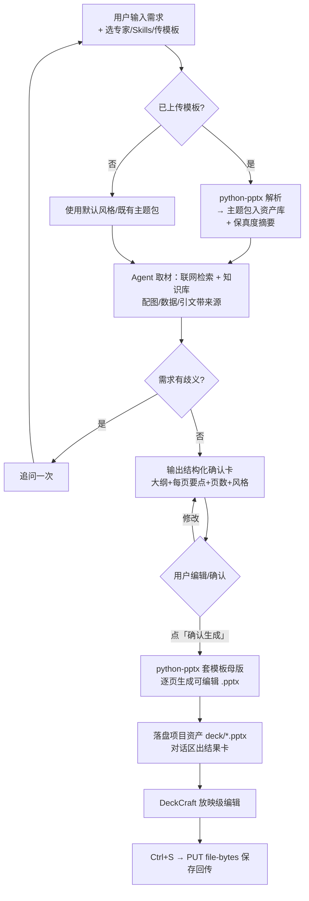

# PRD：AI PPT 制作（增量）

> 版本 v0.1 · 2026-11-10 · 产品经理 许清楚
> 本文档为**增量 PRD**，只描述本次「AI PPT 制作」功能新增/变更部分，不重写全产品。既有能力（agents 会话、experts、skills、kb、deck-editor、项目资产）按现状复用，不再赘述。

---

## 1. 项目信息

- **Language**：中文
- **Programming Language**：前端沿用 Vite + React + TS + MUI + Tailwind CSS；后端沿用 FastAPI（新增 python-pptx 依赖用于模板解析与 PPT 生成）
- **Project Name**：ppt-studio
- **原始需求复述**：在自托管 RAG Agent 平台新增「AI PPT 制作」独立页面。用户输入 PPT 需求，可选专家（含 ppt-beautifier 美化专家）、Skills、上传公司 .pptx 模板；Agent 联网检索 + 读知识库取材后输出可编辑的结构化确认卡（大纲级）；确认后用 python-pptx 套模板母版生成可编辑 .pptx 落盘项目资产，内嵌 DeckCraft 编辑，Ctrl+S 保存回传后端。

## 2. 产品目标与成功标准

| # | 目标 | 成功标准（可衡量） |
|---|------|-------------------|
| G1 | 从需求到可编辑成品的闭环 | 用户在单页内完成「输入 → 确认卡 → 生成 → DeckCraft 编辑 → Ctrl+S 保存」，全程无需跳出页面；生成成功率 ≥ 95% |
| G2 | 公司模板品牌一致性 | 上传 .pptx 模板后，生成稿沿用其色板/字体/版式/页眉页脚；模板包全公司复用（同一模板被 ≥2 个项目引用） |
| G3 | 内容可信有据 | 配图、数据、引文均带来源标注（联网检索或知识库引用），用户可点开溯源 |

**非目标（本次不做）**：逐页两道确认、浏览本地项目文件取材、SmartArt/复杂图表的像素级保真还原、在线协作编辑。

## 3. 用户故事

- **普通用户**：作为普通用户，我想输入一个主题（如"季度经营复盘"）并直接生成 PPT，这样我不用自己找素材和排版。
- **普通用户**：作为普通用户，我想在生成前看到章节大纲、每页要点和页数并直接在确认卡上改，这样成品符合预期，不用生成后再大改。
- **普通用户**：作为普通用户，我想在生成的 PPT 中给图表/引文看到出处，这样汇报时经得起追问。
- **企业用户**：作为有公司模板的企业用户，我想上传一次公司 .pptx 模板，之后所有 PPT 自动套用公司品牌，这样不用每次手动换模板。
- **企业用户**：作为企业用户，我想让美化专家（ppt-beautifier）优化我的初稿或既定风格，这样输出更专业。
- **企业用户**：作为企业用户，当我的模板里有 SmartArt/复杂图表导致解析不完整时，我希望得到明确提示与降级方案（近似版式替代），而不是静默丢失内容。

## 4. 需求池

### P0（Must have — 本次必须做）

| ID | 需求 | 说明 |
|----|------|------|
| P0-1 | 左侧菜单新增「AI PPT 制作」独立页 | 布局对齐 agents 任务页：左会话列表 + 右对话区；新增路由与菜单项 |
| P0-2 | 输入区三件套 | 输入框旁：① 专家下拉（含已有 ppt-beautifier）；② Skills 选择（多选）；③ 公司模板上传（.pptx，走 sandbox.write_bytes 同类二进制上传通道） |
| P0-3 | 模板解析为主题包 | 后端用 python-pptx 解析 .pptx → 主题包（色板/字体/版式/页眉页脚），持久化到资产库，可被全公司项目复用；解析结果可查看、可删除 |
| P0-4 | 取材流水线 | Agent 生成前执行：联网检索 + 知识库（kb）取材；配图/数据/引文必须带来源（URL 或 kb 引用） |
| P0-5 | 结构化确认卡（大纲级） | 流式输出一张可编辑确认卡：章节大纲 + 每页要点 + 页数 + 风格/主题选择；卡上可直接编辑文本、增删章节、改页数；仅当需求有歧义时先追问，否则不出卡直接追问一次 |
| P0-6 | 一键生成 .pptx | 用户点「确认生成」后，python-pptx 按主题包母版逐页生成可编辑 .pptx，落盘到对应项目的 deck 资产目录 |
| P0-7 | DeckCraft 内嵌编辑 | 生成完成后对话区展示卡片入口，点击进入 DeckCraft 放映级编辑（复用 features/deck-editor）；Ctrl+S 经 PUT /projects/{project}/file-bytes 保存回传 |
| P0-8 | 生成状态与错误反馈 | 生成过程有进度反馈（取材中/生成中/完成）；失败时给出可读错误与重试入口 |

### P1（Should have — 本次尽量做）

| ID | 需求 | 说明 |
|----|------|------|
| P1-1 | 模板包管理入口 | 资产页（browser）可查看已解析的主题包列表、预览色板/版式缩略、删除 |
| P1-2 | 解析保真度报告与降级 | 解析后输出保真度摘要：哪些元素（SmartArt/图表/不规则母版）无法完整还原，采用何种降级（近似版式/占位符+提示）；报告在确认卡或生成结果中展示 |
| P1-3 | 确认卡快捷指令 | 卡上提供"更多页/更少页/换个风格"快捷按钮，一键重出卡 |
| P1-4 | 会话复用 | AI PPT 会话沿用 agents 会话列表模型，历史会话可继续追问微调（如"第 3 页换个图表"） |

### P2（Nice to have — 本次不做，仅记录）

- P2-1 多模板混合/手动指定某页版式
- P2-2 生成后自动质检（溢出检测、字号一致性）
- P2-3 导出 PDF / 分享链接
- P2-4 逐页编辑确认（两道确认卡）

### 本次明确不做（范围红线）

- 不浏览本地项目文件作为取材来源（仅联网 + kb）
- 不做逐页两道确认
- 不承诺 SmartArt/复杂图表/不规则母版的像素级保真（走 P1-2 降级口径）

## 5. UI 设计稿（文字版式描述 + Mermaid 图）

### 5.1 页面布局（文字描述）

- **左侧菜单**：新增一级菜单项「AI PPT 制作」（图标建议 Slideshow），点击进入 /ppt-studio。
- **页面主体**：对齐 agents 任务页两栏结构
  - **左栏（会话列表，约 280px）**：新建会话按钮 + 历史 AI PPT 会话列表（标题 + 更新时间），样式复用 features/agents。
  - **右栏（对话区）**：
    - 顶部：当前会话标题 + 关联项目/资产上下文提示。
    - 中部：消息流。Agent 消息中嵌入两类卡片：① 结构化确认卡（可编辑大纲树：章节 → 每页要点，含页数统计、风格/主题选择器、来源标注折叠区）；② 生成结果卡（文件名 + DeckCraft 打开按钮 + 解析保真度提示）。
    - 底部输入区：输入框 + 右侧三件套（专家下拉默认 ppt-beautifier 可换、Skills 多选、模板上传按钮显示已选模板名）。上传后即时校验 .pptx 格式并显示"解析中 → 已就绪"状态。

### 5.2 页面布局图

```mermaid
flowchart LR
    subgraph AppLayout
        Menu[左侧菜单<br/>+ AI PPT 制作]
    end
    Menu --> Page[/ppt-studio 页面/]
    subgraph Page[页面主体：左右两栏]
        direction LR
        Left[左栏：会话列表<br/>新建 + 历史 PPT 会话]
        subgraph Right[右栏：对话区]
            Header[顶部：会话标题/项目上下文]
            Flow[中部：消息流<br/>确认卡 · 生成结果卡]
            Input[底部输入区<br/>输入框 + 三件套<br/>专家下拉 | Skills | 模板上传]
        end
        Left --- Right
    end
```

### 5.3 核心流程图



## 6. 待确认问题

1. **模板包归属与可见范围**：「全公司复用」在当前自托管多租户模型下按什么边界共享？（按部署实例全局共享 vs 按项目组/权限组共享）——建议默认全局共享、资产页可见即可管理。
2. **模板上传入口的会话归属**：确认卡生成前用户切换模板，是否需要重新出卡？建议仅当主题变化影响版式时提示重出卡。
3. **生成落盘的项目归属**：AI PPT 会话默认写到哪个项目（当前选中项目 vs 自动建一个"AI PPT"项目）？建议沿用当前项目上下文，无上下文时提示选择。
4. **联网检索的开关与配额**：是否需要每会话开关联网（内网敏感场景）？建议 P1 提供 per-会话开关。
5. **来源标注形式**：正文角标 / 页尾来源页 / 两者结合？建议默认页尾来源页 + 卡内可溯源，正式稿可配置隐藏。
